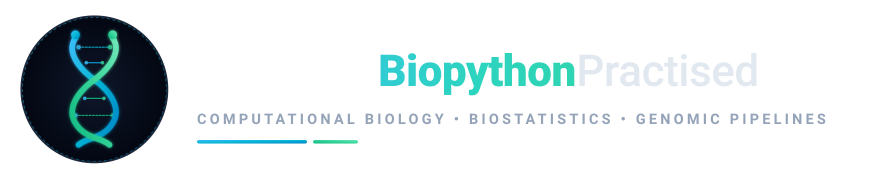

<div align="center">



# 🌐 SuleimanBiopythonPractised Web Portal
### Interactive Computational Biology, ANOVA Laboratory & Molecular Analytics

[](https://suleimanbiopythonpractised.github.io/)
[](https://github.com/SuleimanBiopythonPractised)
[](https://github.com/SuleimanBiopythonPractised/SuleimanBiopythonPractised)
[](https://opensource.org/licenses/MIT)

<p align="center">
  <b>The browser-native interactive frontend presentation layer for sequence manipulation, statistical variance partitioning (ANOVA), and macromolecular 3D rendering.</b>
</p>

[🚀 Visit Live Website](https://suleimanbiopythonpractised.github.io/) • [📦 Sibling Backend Repo](https://github.com/SuleimanBiopythonPractised/SuleimanBiopythonPractised) • [🏢 GitHub Organization](https://github.com/SuleimanBiopythonPractised)

---

</div>

## 📌 Portal Overview

**`SuleimanBiopythonPractised.github.io`** is the public-facing interactive web application for the **SuleimanBiopythonPractised Organization**. It translates Python/Biopython workflows, statistical ANOVA models, and 3D macromolecular structures into real-time browser experiences.

### Key Interactive Features

1. **🧬 Live Biopython Sequence Studio**:
   - In-browser computation of Central Dogma transformations: mRNA transcription ($T \to U$), reverse complementation, and translation with standard genetic code.
   - Real-time physicochemical metrics: Sequence length, GC content (%), AT content (%), molecular weight (kDa), and melting temperature ($T_m$).
   - Quick-load biological presets: Human Insulin, Aequorea GFP, SARS-CoV-2 Spike fragment.

2. **⚡ Dynamic Pairwise Aligner**:
   - Interactive implementations of Global (Needleman-Wunsch) and Local (Smith-Waterman) dynamic programming alignments.
   - Real-time alignment matrix trace, alignment score, and percent identity ($PID$).

3. **📊 Biostatistics ANOVA Laboratory**:
   - Interactive 4-cohort pharmacological drug trial simulation (Control vs Drug A vs Drug B vs Drug C).
   - Real-time derivation of Sum of Squares ($SS_B, SS_W, SS_T$), Degrees of Freedom, Mean Squares ($MS$), $F$-statistic, exact $p$-value, and effect size ($\eta^2$).
   - Dynamic SVG Boxplot & Dot-plot distribution rendering.
   - Post-hoc Tukey HSD pairwise contrast evaluation with significance tags.

4. **🔬 3D Biomolecular Structure Viewer (3Dmol.js)**:
   - Interactive WebGL rendering of protein crystallographic models directly from RCSB and local CIF archives (1FAT Plant Lectin, 1GBT Beta-Lactamase, 4INS Insulin, 1CRN Crambin).
   - Display modes: Ribbon/Cartoon, Molecular Surface, Space-Filling Spheres, Wireframe Sticks.

5. **📚 Practice Notebooks & Curriculum Catalog**:
   - Categorized and searchable directory of 18+ homework modules and biostatistics projects.
   - Filter by domain: Sequence Analysis, ANOVA Statistics, Structural Biology.
   - Direct links to annotated Jupyter Notebooks in the backend repository.

6. **🧠 Obsidian Knowledge Graph Explorer**:
   - Interactive card view of core concepts (One-Way ANOVA, Two-Way ANOVA, Tukey HSD, Central Dogma, Pairwise Alignment), entities (`Bio.Seq`, `Bio.SeqIO`, `Bio.PDB`, `statsmodels`), and syntheses.

---

## 🗂️ Project Structure

```
SuleimanBiopythonPractised.github.io/
├── index.html                  # Master responsive single-page web application
├── manifest.json               # Progressive web app metadata
├── .nojekyll                   # Bypasses Jekyll processing on GitHub Pages
├── favicon.svg                 # Scalable vector tab icon
├── favicon.png                 # 64x64 raster favicon
├── apple-touch-icon.png        # 180x180 iOS touch icon
├── assets/                     # Brand assets
│   ├── logo.svg                # Master vector brand logo
│   ├── logo-icon.svg           # High-resolution vector icon
│   ├── logo-emblem.png         # Neural scientific emblem render
│   └── logo-badge.png          # Alternate badge render
├── css/
│   └── style.css               # Modern design system, glassmorphism, responsive grid
├── js/
│   ├── app.js                  # UI controllers, theme switching, 3Dmol viewer, catalog
│   ├── bio-studio.js           # Sequence operations, physicochemical metrics, aligner
│   └── stats-studio.js         # ANOVA variance decomposition, F-distribution, Tukey HSD
└── data/
    └── notebooks.json          # Structured catalog data for notebooks and exercises
```

---

## 💻 Local Development & Preview

To preview the portal locally on your workstation:

```bash
# Clone the repository
git clone https://github.com/SuleimanBiopythonPractised/SuleimanBiopythonPractised.github.io.git
cd SuleimanBiopythonPractised.github.io

# Launch a simple HTTP server
python3 -m http.server 8000
```

Then open `http://localhost:8000` in your browser.

---

## 🌐 Connected Ecosystem

| Repository | Role | Direct Link |
| :--- | :--- | :--- |
| **Backend Core & Data** | Python scripts, notebooks, datasets, environments | [SuleimanBiopythonPractised](https://github.com/SuleimanBiopythonPractised/SuleimanBiopythonPractised) |
| **Frontend Web Portal** | Interactive website & visualizations (This repo) | [SuleimanBiopythonPractised.github.io](https://github.com/SuleimanBiopythonPractised/SuleimanBiopythonPractised.github.io) |
| **GitHub Organization** | Central administrative hub | [SuleimanBiopythonPractised](https://github.com/SuleimanBiopythonPractised) |

---

## 📜 License
Distributed under the **MIT License**.

© 2026 **Suleiman Hajizadeh** • [SuleimanBiopythonPractised Organization](https://github.com/SuleimanBiopythonPractised)
